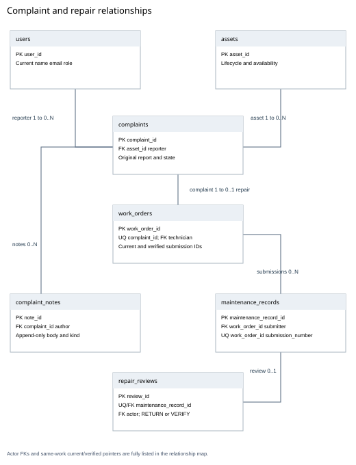
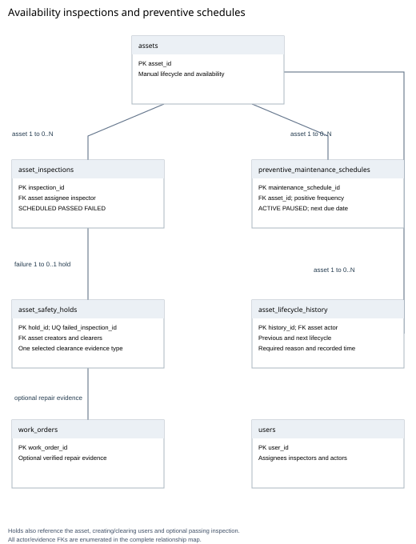
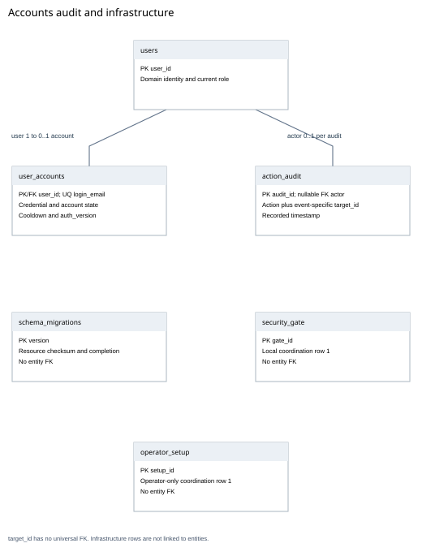
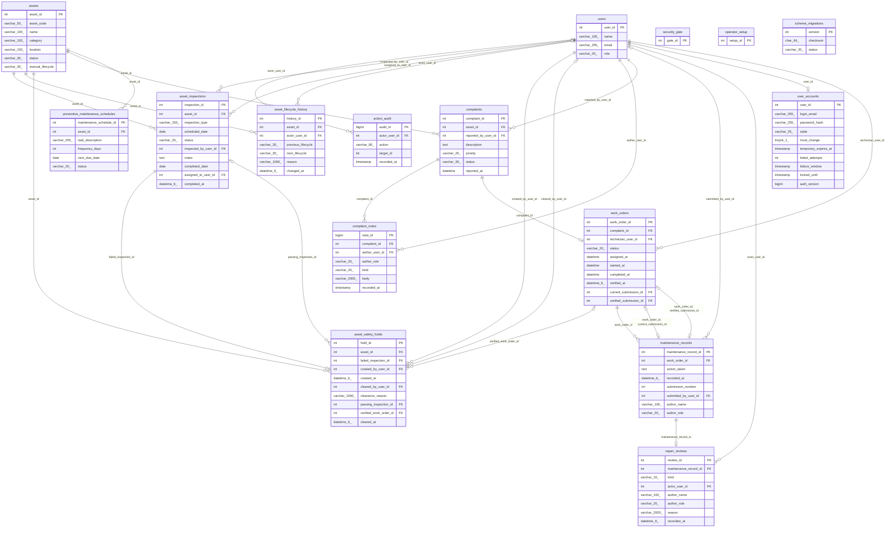

# Final entity relationship diagrams

The current schema contains 16 tables. The complete Mermaid map below enumerates every database FK; the three printable views group related areas for readability. Actor links and some evidence links are summarized in the views and fully enumerated in the relationship table. Standalone metadata tables have no invented relational links.

A complaint has zero or one repair; a repair has zero or many submissions; a submission has zero or one terminal administrator review. Current/verified pointers are optional but must refer to a submission of the same repair.

## Complete relationship map

## Every foreign key

| Child table | Child fields | Referenced table | Referenced fields |
|---|---|---|---|
| `action_audit` | `actor_user_id` | `users` | `user_id` |
| `asset_inspections` | `asset_id` | `assets` | `asset_id` |
| `asset_inspections` | `inspected_by_user_id` | `users` | `user_id` |
| `asset_inspections` | `assigned_to_user_id` | `users` | `user_id` |
| `asset_lifecycle_history` | `asset_id` | `assets` | `asset_id` |
| `asset_lifecycle_history` | `actor_user_id` | `users` | `user_id` |
| `asset_safety_holds` | `asset_id` | `assets` | `asset_id` |
| `asset_safety_holds` | `failed_inspection_id` | `asset_inspections` | `inspection_id` |
| `asset_safety_holds` | `created_by_user_id` | `users` | `user_id` |
| `asset_safety_holds` | `cleared_by_user_id` | `users` | `user_id` |
| `asset_safety_holds` | `passing_inspection_id` | `asset_inspections` | `inspection_id` |
| `asset_safety_holds` | `verified_work_order_id` | `work_orders` | `work_order_id` |
| `complaint_notes` | `author_user_id` | `users` | `user_id` |
| `complaint_notes` | `complaint_id` | `complaints` | `complaint_id` |
| `complaints` | `asset_id` | `assets` | `asset_id` |
| `complaints` | `reported_by_user_id` | `users` | `user_id` |
| `maintenance_records` | `work_order_id` | `work_orders` | `work_order_id` |
| `maintenance_records` | `submitted_by_user_id` | `users` | `user_id` |
| `preventive_maintenance_schedules` | `asset_id` | `assets` | `asset_id` |
| `repair_reviews` | `actor_user_id` | `users` | `user_id` |
| `repair_reviews` | `maintenance_record_id` | `maintenance_records` | `maintenance_record_id` |
| `user_accounts` | `user_id` | `users` | `user_id` |
| `work_orders` | `work_order_id, current_submission_id` | `maintenance_records` | `work_order_id, maintenance_record_id` |
| `work_orders` | `complaint_id` | `complaints` | `complaint_id` |
| `work_orders` | `technician_user_id` | `users` | `user_id` |
| `work_orders` | `work_order_id, verified_submission_id` | `maintenance_records` | `work_order_id, maintenance_record_id` |

PKs, unique keys, field definitions and service/SQL boundaries are in [the data dictionary](data-dictionary.md). No FK is claimed for action_audit.target_id; its action determines the target type.
